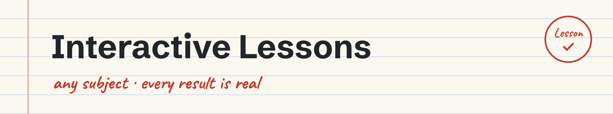
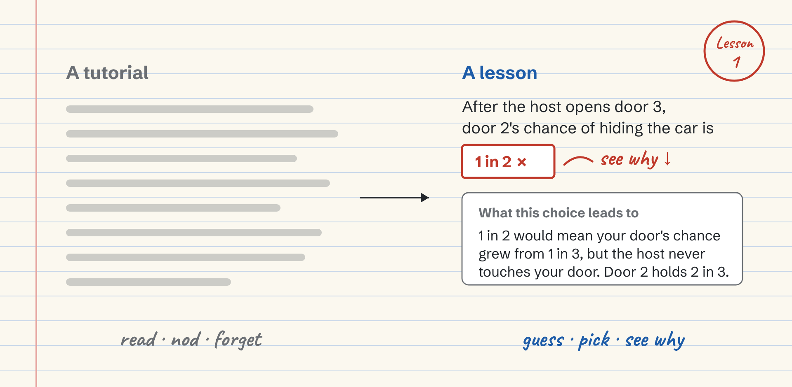
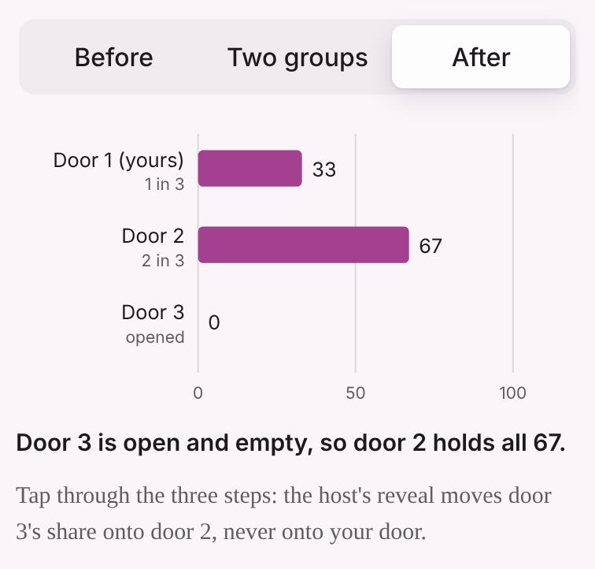
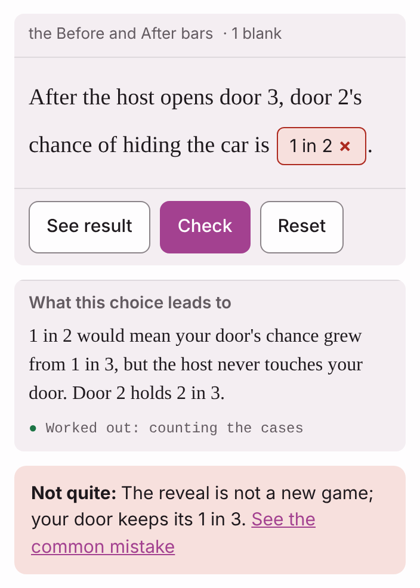
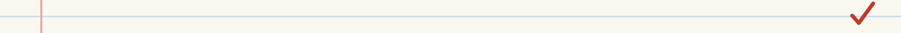
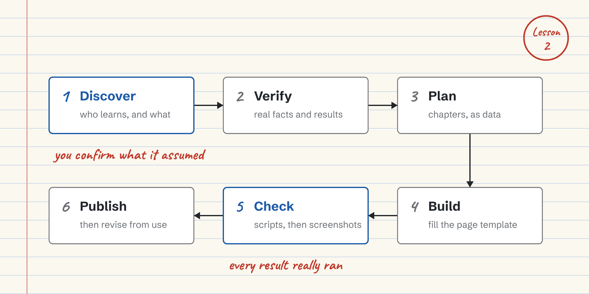
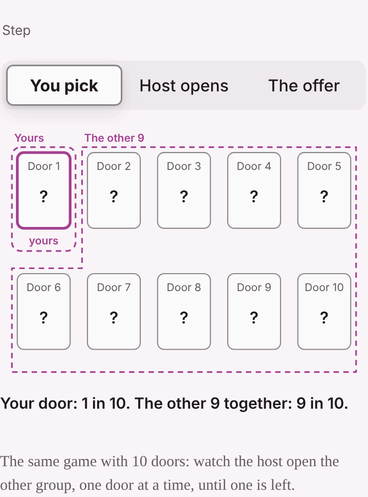
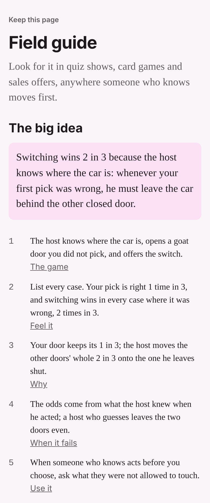

<picture>
  <source media="(prefers-color-scheme: dark)" srcset="docs/images/banner-dark.png">
  
</picture>

<h3 align="center">Reading a tutorial isn't learning.</h3>

<p align="center">Interactive Lessons turns any subject into a lesson where you guess, pick, and see where a wrong choice really leads.</p>

<p align="center"><a href="#install">Install</a> · <a href="#how-it-works">How it works</a> · <a href="#what-a-lesson-gives-you">What a lesson gives you</a> · <a href="#try-it">Try it</a> · <a href="VISION.md">Vision and principles</a></p>

<br>

<picture>
  <source media="(prefers-color-scheme: dark)" srcset="docs/images/tutorial-vs-lesson-dark.png">
  
</picture>
<p><em>Lesson 1 · In a lesson you commit to an answer first, then see where it leads.</em></p>

<p align="center">
  <picture>
    <source media="(prefers-color-scheme: dark)" srcset="docs/images/lesson-bars-dark.png">
    
  </picture>
  <picture>
    <source media="(prefers-color-scheme: dark)" srcset="docs/images/lesson-shot-dark.png">
    
  </picture>
</p>
<p align="center"><em>A real build of the bundled Monty Hall example. Left: tap After, and door 3's chance moves onto door 2, and yours stays at 1 in 3. Right: the learner said 1 in 2, and sees why it is 2 in 3.</em></p>

**Try the lesson itself:** [Stay or Switch?](https://claude.ai/artifact/FRiZUdRWFHotBmPBw1juau) is the bundled example, live in claude.ai. It has 5 chapters of about 5 minutes each. The tutor and the grader ask to use your own Claude account.

<picture><source media="(prefers-color-scheme: dark)" srcset="docs/images/strip-dark.png"></picture>

## How it works

You ask your agent for a lesson on a topic, some docs or a repo. The skill guesses what you already know, asks you to confirm it, and plans the chapters as data. Your agent then runs every example for real, fills a ready page template, and has fresh reviewers check the lesson. Nobody writes the page by hand.

<picture>
  <source media="(prefers-color-scheme: dark)" srcset="docs/images/how-it-works-dark.png">
  
</picture>
<p><em>Lesson 2 · The six steps of the <code>building-interactive-lessons</code> skill.</em></p>

1. **Discover.** Drafts the learner profile, the scope and a colour from what it knows, then asks you to confirm, in at most 4 questions.
2. **Verify.** Marks each fact confirmed or inferred, collects real misconceptions, and runs every code slice and every blank option to record what each really prints.
3. **Plan.** Picks a component for each beat of the story from a catalogue, writes the chapters as a blueprint, and works through a checklist of every rule.
4. **Build.** Fills the page template from the blueprint.
5. **Check.** Three fresh reviewers check it: one re-runs every result and every rule, one uses the lesson as a new learner would, and one taps through every moving picture at phone width, light and dark.
6. **Publish and revise.** Publish as a claude.ai artifact. A feedback round edits the blueprint and re-checks only what changed.

**Each chapter** opens with a guess, teaches one idea at a time, and asks you to fill 1 to 3 blanks in real material: a code slice, a sentence, a rule or a formula. Every wrong option is a real mistake and shows where it really leads. An AI tutor sits beside every block. It gives hints and keeps the solution back. **Hint** and **Show solution** are buttons you press yourself.

<picture><source media="(prefers-color-scheme: dark)" srcset="docs/images/strip-dark.png"></picture>

## What a lesson gives you

- **Pictures designed for the idea.** The skill asks what each idea hides and what about it changes, then builds the picture for it: a tap plays the host opening 8 goat doors one at a time; a slider reshapes a strip of odds and you draw 100 words to see where they land. Moving pictures are proposed with their token cost, and built only when you agree.
- **A tutor that knows the lesson.** Every question you ask carries the chapter's goal, the block you are on, the code around it and the mistakes people often make there. When the answer is not in the lesson and it is unsure, it says so.
- **Checks that test the idea.** Each key idea and each common mistake gets a quiz, and a mistake's card opens only after you answer it. When you explain something in your own words, an AI grader checks it against a rubric and names the first problem.
- **A field guide at the end.** The big idea, one line per chapter with a link back, the questions you got wrong while sure, and where each fact comes from.
- **Progress that keeps.** In claude.ai the page saves each learner's answers, so they can stop and come back.

<p align="center">
  <picture>
    <source media="(prefers-color-scheme: dark)" srcset="docs/images/ten-doors-dark.gif">
    
  </picture>
  <picture>
    <source media="(prefers-color-scheme: dark)" srcset="docs/images/field-guide-dark.png">
    
  </picture>
</p>
<p align="center"><em>From the same example. Left: the host opens the other doors one at a time, so door 7 carries their whole 9 in 10. Right: the field guide on the last page.</em></p>

<picture><source media="(prefers-color-scheme: dark)" srcset="docs/images/strip-dark.png"></picture>

## Install

The skill comes in two editions that make the same lessons. Install one only.

**From Anthropic's plugin directory** (the directory edition): Markdown only. Your agent runs the examples, builds the page and has fresh reviewers check it, following the skill.

**From GitHub** (the scripted edition, on the [`full`](https://github.com/chayapol-p/interactive-lessons/tree/full) branch): scripts record, build and check each lesson. Type these in Claude Code's chat:

```text
/plugin marketplace add chayapol-p/interactive-lessons
/plugin install interactive-lessons@interactive-lessons
```

**Needs:** a code tool that runs Python 3 with PyYAML (both editions). The scripted edition also needs ruamel.yaml, and Playwright with Chromium for its screenshots.

The lesson page works best in claude.ai, where it can ask Claude (the tutor and the grader) and save each learner's progress. Anywhere else it is one HTML file with the AI features hidden.

## Try it

**In your agent's chat:**

```text
Make a 15-minute lesson on why the house always wins at roulette, with pictures. I'm new to it.
```

**What should happen**
- The `building-interactive-lessons` skill offers to run.
- It shows what it assumed you know and asks up to 4 questions: depth, topics, length and colour.
- Where a moment needs it, it offers a moving picture or a game you can play, with its token cost, and builds one only if you say yes.
- It shows a one-screen chapter map and waits for your go.
- It builds `lesson.html`, and ends by saying who checked it: fresh reviewers, or itself when it cannot start them.

**Without an agent,** open [Stay or Switch?](https://claude.ai/artifact/FRiZUdRWFHotBmPBw1juau), the bundled Monty Hall example, live in claude.ai.

<picture><source media="(prefers-color-scheme: dark)" srcset="docs/images/strip-dark.png"></picture>

## What's inside

| Part | What it does |
| --- | --- |
| `SKILL.md` | The skill: 14 rules, 6 steps, the Revise path and a time budget |
| `references/topic-map.md` | For 11 kinds of topic, the component that carries each beat of the story |
| `references/components/` | The catalogue: each component's purpose, its beat, the learner's role, a recipe and its rules, with 5 ready scenes (strip and draws, travel along a path in anime.js or GSAP, pull, pour) |
| `references/self-checks.md` | Every rule a lesson must keep, as a checklist |
| `references/lesson-review.md` | The three reviewers, their briefs and their report |
| `references/building-the-page.md` | How the agent records every result and fills the template |
| `assets/page-template.md` | The lesson page: blanks, hints, solutions, read-along, pictures, scenes, tutor, grader, progress, themes |
| `assets/` examples | 3 blueprints: Stay or Switch? (5 chapters, no code), text chunking (code) and How LLMs Work (6 chapters, with scenes) |
| `references/` | Also: principles, picture design, diagrams, chapter design, quizzes, blueprint format, theme, page behaviour, tutor and grader |

## How a lesson is checked

- **Three reviewers who did not write it.** A content reviewer works through every rule and runs every example again. A learner reviewer uses the page at phone width as a new learner and ends by teaching the big idea back. A scene reviewer taps through every step of every moving picture, light and dark, with motion on and off.
- **No agents, no pretending.** In a plain claude.ai chat the agent runs the same checklists itself and tells you the lesson was self-checked, not reviewed.
- **The scripted edition** on `full` runs the same rules as scripts, with 26 deliberate breaks that its tests catch.
- **Where the rules came from:** most come from problems found in real lessons, such as a RAG workshop lesson with 7 chapters and a How LLMs Work lesson with 6 chapters.
- **Limits:** the trigger prompts and behaviour cases in `evals/evals.json` are written but not yet run as a suite, so this README makes no pass-rate claim.

## Why it works this way

- **You answer at every step.** Every chapter asks for a guess, a filled blank or an answer in your own words.
- **Every result is real.** The page runs no code. Each result is recorded from a real run, quoted from a named source, or worked out in steps.
- **Wrong answers teach.** Each wrong option is a real mistake, with its own reason and its own result.
- **Quizzes test the idea.** A quiz never asks you to recall a detail of the example, such as a rule number.
- **Assume, then confirm.** It starts from what it knows about you and checks it with you before it builds.

The full list of 25 principles, with the source of each, is in [VISION.md](VISION.md).

## Privacy

A lesson page loads its fonts from Google Fonts, and a page with a moving scene that uses a motion library loads it (anime.js or GSAP) from jsDelivr. The tutor and the grader send your question and the lesson's context to Claude through your own account. In claude.ai, the page saves your answers to that lesson so you can come back. The plugin itself collects nothing and runs no server.

## Credits

Ideas come from open teaching skills (make-it-learnable, teach, ape-teach, explain-diff, code-learn-skill), DataCamp's exercise design, PRIMM and Mayer's principles of multimedia learning. Links are in [VISION.md](VISION.md#8-influences-and-credits).

## Contributing and license

See [CONTRIBUTING](CONTRIBUTING.md). MIT License, see [LICENSE](LICENSE).

<sub>README pictures are drawn by <code>docs/diagram/build_pictures.py</code> in Schibsted Grotesk and Caveat, both under the SIL Open Font License.</sub>
